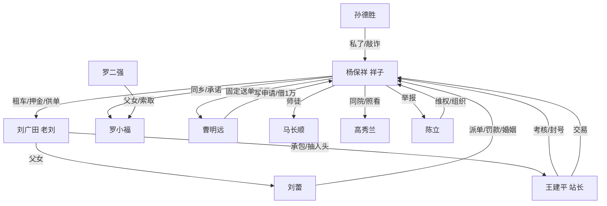

# 人物与关系

## 一、主要人物小传

### 杨保祥（祥子）｜1996.2— ｜河南周口郸城杨庄｜骑手
- 外形：178 cm，62 kg，肩宽背直，皮肤黑，右眉骨一道旧疤（13 岁被拖拉机摇把打的），常年短寸头。左手虎口有烫伤（炸串店打工）。
- 前史：母亲 2008 年病逝，父亲杨守田 2016 年胃癌去世，治病欠 4.2 万元（舅舅 2.4 万、信用社 1.8 万）。姐姐杨保芝嫁在县城，开小卖部。奶奶 82 岁，瘫痪在床。
- 学历/经历：高中毕业；2015—2016 在郑州工地做小工；2017 在快递分拣中心上夜班。
- 目标（表层）：买一辆自己的车，不再交车租。
- 目标（深层）：不当"被安排的人"。他把"自己的车"当成"自己说了算"的凭证。
- 资源：体力、方向感、记账的习惯（一个蓝色塑料皮本子，记到 2021 年 1 月 19 日停）、会修车。
- 弱点：把结构问题当成个人能力问题；不擅长求助；对"欠人情"极度敏感；一旦被逼到墙角，会选择伤害比他更弱的人。
- 底线变化：2018 年"不闯红灯、不骗人"→ 2020 年"闯黄灯、替人打卡"→ 2023 年"卖人"。
- 说话方式：短句，少用形容词，爱用数字（"还有 6 分钟""差 300 块"）；着急时重复对方的话；不说"谢谢"，说"记着"。

### 刘蕾（蕾姐）｜1984.11—2021.1 ｜杭州彭埠｜站点调度
- 外形：158 cm，偏胖，烫小卷，眉毛纹过（发青），左腕一只金镯子，指甲总是红的。说话嗓门大，笑起来整条走廊都听见。
- 前史：中专毕业，四季青服装档口做过 6 年，2015 年离婚（前夫做布料生意欠债跑路，她替他还了 7 万），2016 年流过一次产。
- 工作：新塘站调度，管派单、罚款、招聘、考勤。她能在系统里"挪"单，也能在系统里"卡"人。
- 目标：找一个"不会跑的男人"，生一个孩子，把车行和站点的关系接过来。
- 资源：钱（自己攒 6 万）、信息（谁被罚、谁要辞工）、人情（和老刘的客户、和几位商家老板）。
- 弱点：高血压、空腹血糖 7.8（不肯查）、怕人说她"生不出"；把控制当成照顾。
- 底线：可以对骑手凶，不克扣工资；可以骗祥子结婚，不骗他的钱。
- 说话方式：命令句多（"你听我说""这事就这么定"）；亲热时叫"祥子"，生气时叫"杨保祥"；爱用"我们杭州人"和"你们外地人"划界，但从不真拿这个压他。

### 罗小福｜1999.6—2022.3 ｜河南周口郸城罗楼｜足浴店技师
- 外形：155 cm，瘦，马尾，睫毛很长，右手食指有烫伤的茧（给客人拔罐）。总穿一件洗得发白的粉色卫衣。
- 家庭：父罗二强（1970，酗酒，在杭州跑三轮、搬家），母赵桂枝（类风湿，在老家），两个弟弟（13、11 岁，在老家读书）。
- 工作：四季青"丽人足道"技师，底薪 2500＋提成，住 8 人宿舍；2021 年被父亲介绍去 KTV"做前台"，实际是陪酒。
- 目标：攒 3 万给母亲做手术；想让祥子"有一天来接她"。
- 资源：手艺、忍耐、一张会笑的脸。
- 弱点：不会拒绝父亲；把"被人需要"当成"被人爱"。
- 说话方式：轻声，句尾带"嗯""啊"；紧张时重复"没事的"；从不主动要东西，只说"你有空吗"。

### 刘广田（老刘）｜1965— ｜彭埠｜车行老板、站点合作商
- 外形：165 cm，啤酒肚，POLO 衫扎进裤腰，钥匙串挂在皮带上有七把钥匙。
- 生意：广田车行（租车、修车、代办上牌）＋给新塘站供车供人，抽人头费 200 元/人。
- 目标：把女儿嫁出去，把车行的牌照和站点合同攥在手里，不动自己的两套房。
- 弱点：怕女儿、怕查账、怕"上面"换承包商。
- 说话方式：先笑后说，爱说"好说好说"，从不给准话。

### 曹明远｜1973— ｜高校教师｜文三路求智巷
- 外形：180 cm，瘦，眼镜，衬衫洗得发软，骑一辆二八自行车。
- 家庭：妻周红（1975，医院药剂科），女曹雨（2006，初二）。
- 与祥子：固定点他家楼下的面馆；请他进屋喝过三次茶；教他"凡事留证据"；2021 年帮他写劳动仲裁申请。
- 转折：2020 年因一篇访谈被约谈，2021 年停课一学期，书店合伙项目关停，2021 年 8 月举家搬去南京。
- 说话方式：慢，爱用"你看啊"开头，讲道理时举例，不说空话。

### 马长顺（老马）｜1963— ｜河南信阳｜老骑手
- 跑单 7 年，先在南京后到杭州；儿子马涛在老家开货车，孙子马小雨（2013 生）有先天性心脏病，等手术费 8 万。
- 外形：精瘦，背驼，右膝盖有旧伤，雨天瘸。
- 作用：祥子的"未来镜像"。他教会祥子看单、看路、看人；也是第一个告诉祥子"车不是你的，单才是平台的"的人。
- 结局：2022 年冬摔车，锁骨骨折，站点按"众包无工伤"处理，赔 3000 元"人道补助"，回信阳。

### 高秀兰（高姐）｜1970— ｜安徽阜阳｜钟点工
- 五堡 12 号二房东，租三间转租两间；丈夫老周在工地。
- 作用：祥子在杭州唯一"不带利益"的熟人；她的厨房是这部小说的客厅。
- 说话方式：快，爱插话，爱说"我跟你说"。

### 孙德胜（孙哥）｜1979— ｜彭埠｜停车场管理员、"代办"
- 与协警、拖车、修车厂都有关系；2019 年 5 月"处理"祥子的剐蹭，收 12000。
- 说话方式：永远先递烟，永远说"我帮你问问"。

### 王建平（王站长）｜1987— ｜安徽｜新塘站站长
- 加盟商雇的职业经理人，KPI 是准时率、投诉率、活跃骑手数。
- 2023 年 3 月封祥子账号，又"帮忙"解封。
- 说话方式：爱说"公司规定"，被逼急了说"我也要吃饭"。

### 陈立（老陈）｜1986— ｜前骑手｜公众号"骑手观察"
- 2022 年建"新塘兄弟群"，组织过一次停送（两小时），被站点记恨。
- 2023 年 3 月被祥子交出行踪与聊天记录，账号被封、房东逼退租，离开杭州。

## 二、关系图

## 三、关系的三重结构

| 关系 | 情感 | 利益 | 权力 |
| --- | --- | --- | --- |
| 祥子—刘蕾 | 依赖、厌烦、愧疚 | 她的 6 万与车、他的工资卡 | 她掌握派单与信息，他掌握体力 |
| 祥子—老刘 | 敬畏、怨恨 | 租金、押金、彩礼 | 老刘掌握车与合同 |
| 祥子—小福 | 怜惜、承诺、逃避 | 他给她钱，她给他"还有人在等他" | 他比她多一点点资源，这点资源让他成为她的希望，也让他能拖延 |
| 祥子—曹明远 | 敬重、隔膜 | 固定单、借款、仲裁 | 曹有知识与制度通道，但没有执行力 |
| 祥子—老马 | 师徒、同类 | 无 | 老马教会他规则，也让他看见尽头 |
| 祥子—王站长 | 对抗、共谋 | 罚款、封号、解封 | 王代表系统，祥子代表单量 |
